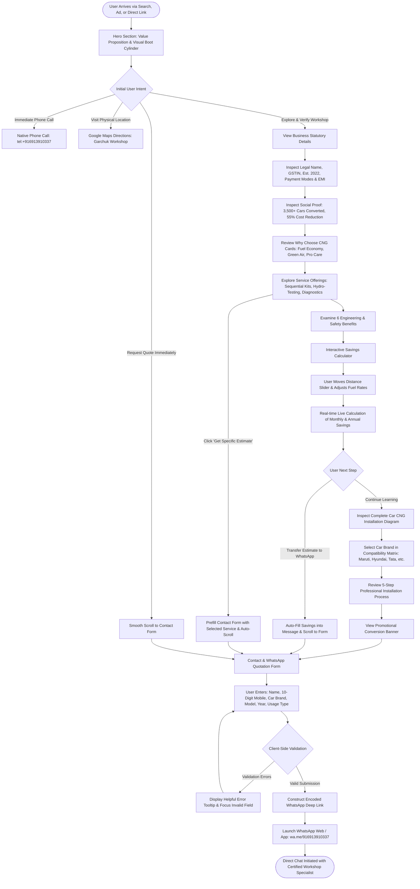
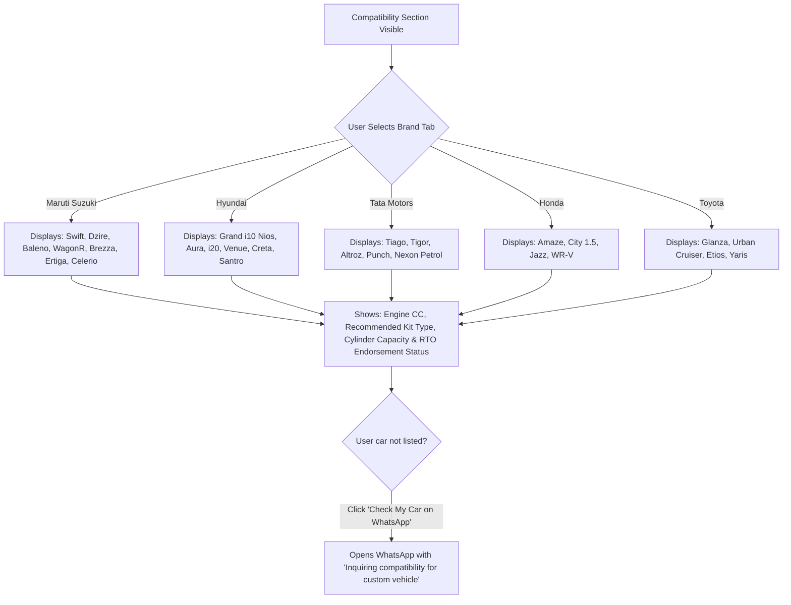
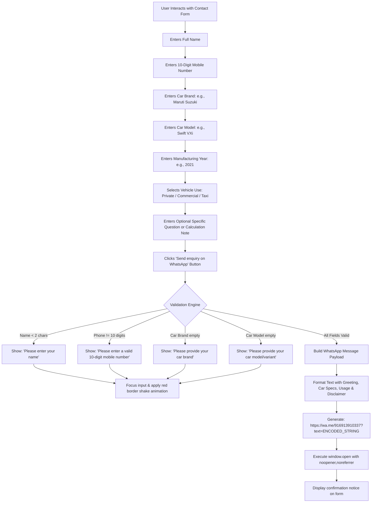

# Application User Flow & Navigation Architecture (APP_FLOW.md)

## Project Information
- **Project Name:** Maa Kamakhya Auto Gas Web Platform
- **Legal Entity:** Maa Kamakhya Auto Gas
- **Document Version:** 1.0.0 (Production Release)
- **Status:** Approved / Interaction Baseline
- **Last Updated:** 2026-11-15
- **Document Owner:** Lead UX Designer & Systems Flow Architect

---

## 1. End-to-End Primary User Journey



---

## 2. Step-by-Step Navigation & Page Transition Flows

### 2.1 Sticky Header Navigation & Scrollspy
1. **Initial Header State:** The navigation bar is rendered fixed at `top: 0; left: 0; right: 0; z-index: 1000;`. On scroll, a subtle backdrop-blur (`backdrop-filter: blur(12px)`) and navy background (`rgba(7, 21, 44, 0.92)`) are engaged.
2. **Desktop Link Interaction:**
   - User clicks any anchor: `Benefits`, `Services`, `Savings Calculator`, `Compatibility`, `How It Works`, `Location`, or `Contact`.
   - The browser initiates a smooth scroll (`scroll-behavior: smooth`) toward the corresponding section ID.
   - A global `scroll-margin-top: 80px` prevents the sticky navbar from occluding section headers.
3. **Scrollspy Tracking:**
   - An active Intersection Observer monitors visible sections.
   - The corresponding link in the navbar is dynamically styled with an active yellow indicator (`#FFD52A`) and subtle background highlight.
4. **Quick Action Triggers:**
   - **"Call" button:** Triggers `tel:+916913910337`.
   - **"WhatsApp" button:** Dispatches an immediate introductory WhatsApp chat link.

---

## 3. Detailed Sub-Flows & User Decision Trees

### 3.1 Fuel Savings Calculator Decision Tree

```mermaid
flowchart TD
    CalcEntry[User Focuses on Savings Calculator] --> DefaultState[Default: 5,000 km, ₹107/L Petrol, ₹91/kg CNG, 15 km/L, 27 km/kg]
    DefaultState --> DisplayDefault[Displays: Petrol ₹35,667 | CNG ₹16,852 | Net Savings ₹18,815/mo]
    
    DisplayDefault --> UserChange{User Adjustment}
    UserChange -->|Drags Distance Slider| UpdateDist[Slider moves: 500 km to 10,000 km range]
    UserChange -->|Changes Petrol Price| UpdatePP[Petrol price input modified: e.g., ₹105 - ₹110]
    UserChange -->|Changes CNG Price| UpdateCP[CNG price input modified: e.g., ₹88 - ₹95]
    UserChange -->|Changes Petrol Mileage| UpdatePM[Mileage modified: e.g., 12 to 22 km/L]
    UserChange -->|Changes CNG Mileage| UpdateCM[CNG mileage modified: e.g., 20 to 32 km/kg]
    
    UpdateDist --> PureRecompute[Pure JS recompute in useMemo: < 1ms execution]
    UpdatePP --> PureRecompute
    UpdateCP --> PureRecompute
    UpdatePM --> PureRecompute
    UpdateCM --> PureRecompute
    
    PureRecompute --> UpdateUI[Instant Reactive Animated Numbers: Petrol, CNG, Net Monthly & Annual Savings]
    UpdateUI --> TransferCTA{Click 'Apply Estimate to WhatsApp'}
    
    TransferCTA --> FormFill[Prefills Contact Form with: 'Estimated monthly travel: X km. Calculated savings: ₹Y/mo.']
    FormFill --> ScrollToContact[Smoothly scrolls user directly to Contact Form]
```

### 3.2 Vehicle Compatibility Matrix Selection Flow



---

## 4. WhatsApp Form Submission & Serialization Flow



### Form Serialization Format:
```
Hello Maa Kamakhya Auto Gas team,

I would like to request a CNG conversion estimate for my vehicle:

• Name: [Customer Name]
• Phone: [Customer Phone]
• Vehicle Brand: [Car Brand]
• Model / Variant: [Car Model]
• Manufacturing Year: [Year]
• Usage: [Private / Commercial]
• Details/Savings: [User Note or Calculated Savings]

Please share recommended kit options, warranty, and installation timeline.
```

---

## 5. Mobile Drawer Navigation Flow
1. **Drawer Trigger:** On screens $< 1024px$, the horizontal navigation links collapse into an accessible hamburger icon button (`aria-label="Toggle navigation menu"`).
2. **Open Transition:** Clicking the hamburger toggles the drawer state (`isOpen: true`). An overlay backdrop fades in, and the mobile drawer slides down with smooth CSS transitions (`transform: translateY(0); opacity: 1;`).
3. **Scroll Lock:** Background body scrolling is gently restricted while the drawer is expanded.
4. **Selection & Dismissal:**
   - Clicking any section anchor link triggers `setIsOpen(false)` and smoothly scrolls to the target.
   - Clicking the backdrop outside the drawer menu triggers `setIsOpen(false)`.
   - Pressing the `Escape` key immediately closes the drawer.

---

## 6. Error & Edge Case Handling Flows

| Edge Case | User Condition | System Response / Fallback Handling |
|---|---|---|
| **Invalid Form Submission** | User leaves phone number incomplete or enters non-numeric characters. | Real-time input masking limits entry to digits; on submission, an inline error badge alerts the user and smoothly scrolls/focuses the input. |
| **WhatsApp Block / Non-Installation** | User is on desktop without WhatsApp Web logged in. | The WhatsApp web redirect prompt opens in a new tab; fallback telephone number `6913910337` is visibly displayed beside the form. |
| **Extreme Calculator Inputs** | User enters ₹0 or negative fuel prices. | Input constraints clamp prices to valid operational ranges (min ₹40/kg, max ₹200/L); prevents NaN or negative cost calculations. |
| **Slow Cellular Network (2G/3G)** | Network latency prevents instant asset loading. | Critical layout is rendered purely via inline CSS and system fallbacks; zero layout shift occurs; text content and calculator remain 100% interactive instantly. |
| **Reduced Motion Preference** | User has `prefers-reduced-motion: reduce` configured at the OS level. | All slide and fade animations are bypassed; scroll transitions occur instantaneously. |
