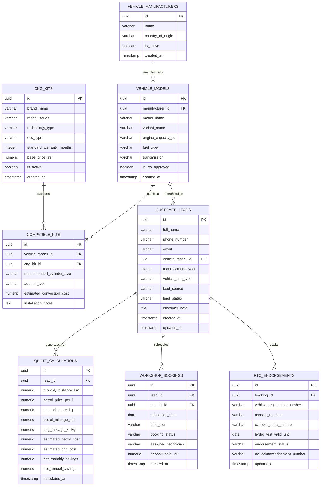

# Database Architecture & Schema Specification (DATABASE_SCHEMA.md)

## Project Information
- **Project Name:** Maa Kamakhya Auto Gas Web Platform
- **Legal Entity:** Maa Kamakhya Auto Gas
- **Document Version:** 1.0.0 (Production Release)
- **Status:** Approved / Future Backend Architectural Baseline
- **Last Updated:** 2026-11-15
- **Document Owner:** Lead Database Architect & Backend Engineer

---

## 1. MVP Architectural Classification: Zero-Database Static Architecture

> [!IMPORTANT]
> **MVP Production Status: NO DATABASE REQUIRED**
>
> The current production release of the **Maa Kamakhya Auto Gas** web platform operates as a **100% client-side, zero-database Single Page Application (SPA)**.
>
> - **Savings Calculations:** Executed entirely within the client's browser runtime using pure mathematical functions (`src/utils/calculator.js`). No calculation data is transmitted to or stored on any server.
> - **Quotation & Inquiries:** Handled through direct URL serialization into the official **WhatsApp Business API** (`https://wa.me/916913910337`), establishing instant peer-to-peer customer communication without collecting or storing Personally Identifiable Information (PII) on a web server.
> - **Operational Benefits:** Zero database hosting expenses, zero database maintenance overhead, zero risk of server-side data leaks, and absolute immunity to SQL injection vulnerabilities.

---

## 2. Proposed Future Backend Schema (Post-MVP Architecture)

For subsequent roadmap phases (e.g., Phase 2 / Phase 3), when Maa Kamakhya Auto Gas introduces a dedicated customer portal, RTO endorsement tracker, and workshop bay management CRM, the following **PostgreSQL 15+** relational schema is specified.

---

## 3. Entity-Relationship Diagram (ERD)



---

## 4. Detailed Table Specifications

### 4.1 Table: `customer_leads`
Captures inbound prospective customer inquiries initiated via web forms, direct calls, or WhatsApp fallbacks.

| Column Name | Data Type | Constraints | Description |
|---|---|---|---|
| `id` | `UUID` | `PRIMARY KEY, DEFAULT gen_random_uuid()` | Unique immutable identifier for the lead. |
| `full_name` | `VARCHAR(100)` | `NOT NULL` | Customer's full name. |
| `phone_number` | `VARCHAR(15)` | `NOT NULL, CHECK (phone_number ~ '^\+?[0-9]{10,14}$')` | Verified mobile phone number. |
| `email` | `VARCHAR(150)` | `NULL, CHECK (email ~* '^[A-Z0-9._%+-]+@[A-Z0-9.-]+\.[A-Z]{2,}$')` | Optional contact email address. |
| `vehicle_brand` | `VARCHAR(50)` | `NOT NULL` | Car make (e.g., Maruti Suzuki, Hyundai). |
| `vehicle_model` | `VARCHAR(80)` | `NOT NULL` | Car model & variant (e.g., Swift VXi). |
| `manufacturing_year` | `SMALLINT` | `NOT NULL, CHECK (manufacturing_year BETWEEN 2000 AND 2030)` | Year of vehicle manufacturing. |
| `vehicle_use_type` | `VARCHAR(20)` | `NOT NULL, DEFAULT 'Private'` | Enum check: `'Private'`, `'Commercial'`, `'Taxi'`. |
| `lead_status` | `VARCHAR(25)` | `NOT NULL, DEFAULT 'New'` | Status: `'New'`, `'Contacted'`, `'Inspection Scheduled'`, `'Converted'`, `'Lost'`. |
| `lead_source` | `VARCHAR(30)` | `NOT NULL, DEFAULT 'Website Form'` | Acquisition origin: `'Website Form'`, `'WhatsApp Click'`, `'Direct Call'`. |
| `customer_notes` | `TEXT` | `NULL` | Custom customer inquiry or special requests. |
| `created_at` | `TIMESTAMPTZ` | `NOT NULL, DEFAULT NOW()` | Record creation timestamp. |
| `updated_at` | `TIMESTAMPTZ` | `NOT NULL, DEFAULT NOW()` | Record modification timestamp. |

### 4.2 Table: `quote_calculations`
Logs calculator parameter configurations to analyze regional customer driving patterns and projected ROI.

| Column Name | Data Type | Constraints | Description |
|---|---|---|---|
| `id` | `UUID` | `PRIMARY KEY, DEFAULT gen_random_uuid()` | Unique calculation record identifier. |
| `lead_id` | `UUID` | `NULL, REFERENCES customer_leads(id) ON DELETE SET NULL` | Optional foreign key linking calculation to a customer lead. |
| `monthly_distance_km` | `NUMERIC(7, 2)` | `NOT NULL, CHECK (monthly_distance_km > 0)` | Monthly travel distance in kilometres. |
| `petrol_price_inr` | `NUMERIC(5, 2)` | `NOT NULL, CHECK (petrol_price_inr > 0)` | Petrol price per litre utilized in computation. |
| `cng_price_inr` | `NUMERIC(5, 2)` | `NOT NULL, CHECK (cng_price_inr > 0)` | CNG price per kg utilized in computation. |
| `petrol_mileage_kml` | `NUMERIC(4, 2)` | `NOT NULL, CHECK (petrol_mileage_kml > 0)` | Petrol fuel economy baseline. |
| `cng_mileage_kmkg` | `NUMERIC(4, 2)` | `NOT NULL, CHECK (cng_mileage_kmkg > 0)` | CNG fuel economy baseline. |
| `petrol_monthly_cost` | `NUMERIC(10, 2)` | `NOT NULL` | Computed monthly petrol expenditure in INR. |
| `cng_monthly_cost` | `NUMERIC(10, 2)` | `NOT NULL` | Computed monthly CNG expenditure in INR. |
| `net_monthly_savings` | `NUMERIC(10, 2)` | `NOT NULL` | Monthly financial savings in INR. |
| `net_annual_savings` | `NUMERIC(12, 2)` | `NOT NULL` | Annual financial savings in INR. |
| `created_at` | `TIMESTAMPTZ` | `NOT NULL, DEFAULT NOW()` | Calculation timestamp. |

### 4.3 Table: `cng_kits`
Authoritative catalog of government-approved sequential CNG kits and hardware.

| Column Name | Data Type | Constraints | Description |
|---|---|---|---|
| `id` | `UUID` | `PRIMARY KEY, DEFAULT gen_random_uuid()` | Unique kit identifier. |
| `brand_name` | `VARCHAR(50)` | `NOT NULL` | Manufacturer brand (e.g., Motozen, Lovato, Tomasetto Achille, BRC). |
| `model_series` | `VARCHAR(80)` | `NOT NULL` | Series designation (e.g., Sequential OBD-II Pro). |
| `technology_type` | `VARCHAR(40)` | `NOT NULL` | Sequential EFI / Direct Injection / Dual-Stage. |
| `cylinder_capacity_litres` | `SMALLINT` | `NOT NULL` | Water capacity: 12L / 14L / 60L / 65L. |
| `warranty_period_months` | `SMALLINT` | `NOT NULL, DEFAULT 24` | Comprehensive workshop warranty duration. |
| `base_cost_inr` | `NUMERIC(10, 2)` | `NOT NULL` | Base price including standard fitting. |
| `is_active` | `BOOLEAN` | `NOT NULL, DEFAULT TRUE` | Active availability status in workshop inventory. |

---

## 5. Indexing Strategy & Performance Optimization

```sql
-- Fast lookup index for active leads sorted by recency
CREATE INDEX idx_leads_created_at ON customer_leads (created_at DESC);

-- Fast search index by phone number for CRM customer lookup
CREATE INDEX idx_leads_phone ON customer_leads (phone_number);

-- Status filtering index for workshop lead dashboard
CREATE INDEX idx_leads_status ON customer_leads (lead_status);

-- Analytical aggregation index on quote calculations
CREATE INDEX idx_quotes_created ON quote_calculations (created_at DESC);
```

---

## 6. Data Validation & Security Rules
1. **Phone Number Sanitization:** Indian mobile numbers must strictly normalize to standard 10 digits before persistence.
2. **Data Retention Policy:** In compliance with Indian digital privacy guidelines, customer inquiry records older than 24 months without active service history may be archived or purged upon customer request.
3. **Role-Based Access Control (RBAC):**
   - `workshop_technician`: Read-only access to customer vehicle models and installation specs.
   - `workshop_manager`: Full read/write access to customer leads, quotes, and RTO status.
   - `auditor / admin`: Full administrative access to statutory and billing reports.
