# Implementation Plan & Milestone Roadmap (IMPLEMENTATION_PLAN.md)

## Project Information
- **Project Name:** Maa Kamakhya Auto Gas Web Platform
- **Legal Entity:** Maa Kamakhya Auto Gas
- **Document Version:** 1.0.0 (Production Release)
- **Status:** Approved / Execution Baseline
- **Last Updated:** 2026-11-15
- **Document Owner:** Technical Project Manager & Lead Software Engineer

---

## 1. Development Phases Overview

The project is structured into 10 structured, verifiable milestones executed sequentially to ensure zero regression, complete brand fidelity, and production stability:

```mermaid
flowchart LR
    M1[M1: Workspace & Tooling] --> M2[M2: Brand & Design System]
    M2 --> M3[M3: Core Layout & Navigation]
    M3 --> M4[M4: Hero & Statutory Details]
    M4 --> M5[M5: Services & Trust Architecture]
    M5 --> M6[M6: Interactive Savings Engine]
    M6 --> M7[M7: Technical Schematic & Compatibility]
    M7 --> M8[M8: WhatsApp Quotation Engine]
    M8 --> M9[M9: Performance & a11y Hardening]
    M9 --> M10[M10: Verification & Production Launch]
```



---

## 2. Milestone Breakdown & Detailed Task Checklist

### Milestone 1: Workspace Setup, Scaffolding & Tooling
- [x] Initialize React 18 + Vite 5 workspace with modern JavaScript tooling.
- [x] Configure enterprise folder architecture (`docs/`, `public/images/`, `public/icons/`, `src/assets/`, `src/components/`, `src/sections/`, `src/layouts/`, `src/pages/`, `src/services/`, `src/data/`, `src/utils/`, `src/styles/`, `src/config/`, `tests/`).
- [x] Install runtime dependencies (`lucide-react`) and verify zero security vulnerabilities.
- [x] Establish `.env.example`, `.gitignore`, and `vite.config.js`.

### Milestone 2: Brand Identity & CSS Design Tokens
- [x] Eradicate all obsolete brand references; enforce **Maa Kamakhya Auto Gas** across all files.
- [x] Implement Yellow + Navy Blue design tokens in `src/styles/variables.css` (`#07152C`, `#0B2142`, `#1677FF`, `#55A4FF`, `#FFD52A`, `#F7F9FF`).
- [x] Import Google Fonts (`Outfit` + `Plus Jakarta Sans`) with preconnect and swap headers.
- [x] Create vector dynamic `<Logo />` component (`src/components/Logo.jsx`) with Yellow + White automotive typography.

### Milestone 3: Core Layout, Navigation & Scrollspy
- [x] Build `MainLayout.jsx` wrapping global header, semantic `<main>`, footer, and floating buttons.
- [x] Implement `Navbar.jsx` with sticky header, 12px blur backdrop, desktop links, and mobile slide-out drawer.
- [x] Add 80px scroll-margin offset to all anchor targets to eliminate header overlap.
- [x] Integrate Intersection Observer for dynamic active-link scrollspy tracking.
- [x] Create `WhatsAppButton.jsx` persistent floating action button with pulsing radar ring.

### Milestone 4: Hero Section & Business Statutory Details
- [x] Implement `Hero.jsx` with headline "Switch to CNG. Save More. Drive Smarter." and verified action buttons.
- [x] Add high-resolution automotive boot cylinder photography asset.
- [x] Implement `StatutoryDetails.jsx` positioned as the **Top 2nd section** right beneath Hero.
- [x] Populate verified statutory credentials: Legal Name (`Maa Kamakhya Auto Gas`), Est. `2022`, Employees (`Less than 10`), Turnover (`51 Lakh – 1 Crore`), GSTIN (`18**********1ZS` with Assam badge), and accepted payment methods.

### Milestone 5: Trust Indicators, Value Proposition & Services Catalog
- [x] Implement `TrustIndicators.jsx` with 4 verified metrics: 3,500+ installs, 55% savings, 100% zero-leak compliance, 2-year warranty.
- [x] Build `WhyChooseUs.jsx` with 3 core value cards: Potential Fuel Savings, Cleaner Mobility Choice, Professional Retrofitment.
- [x] Build `Services.jsx` showcasing 6 automotive services with technical bullets and quote triggers.
- [x] Build `Benefits.jsx` showcasing 6 technical advantages (sequential injection, certified cylinders, etc.).

### Milestone 6: Interactive Fuel Savings Calculator Engine
- [x] Build pure calculation algorithm `src/utils/calculator.js` with zero dependencies.
- [x] Write comprehensive unit tests in `tests/unit/calculator.test.js`.
- [x] Implement `SavingsCalculator.jsx` with interactive distance slider (`500 km` to `10,000 km`) and 4 editable price/mileage inputs.
- [x] Implement real-time reactive calculation via `useMemo` displaying monthly and annual savings.
- [x] Add "Apply Estimate to WhatsApp Enquiry" cross-section event pre-populating contact form.

### Milestone 7: Technical Schematic, Vehicle Compatibility & 5-Step Process
- [x] Implement `SystemOverview.jsx` with cutaway diagram annotating underbody piping, cylinder mounting, and sequential ECU.
- [x] Implement `VehicleCompatibility.jsx` with interactive brand tabs (Maruti Suzuki, Hyundai, Tata, Honda, Toyota).
- [x] Implement `Process.jsx` with 5-step engineering and safety protocol.
- [x] Implement `CTASection.jsx` promotional banner.

### Milestone 8: WhatsApp Quotation Engine & Location Details
- [x] Build `src/services/whatsappService.js` for structured message formatting and URL encoding.
- [x] Implement `Contact.jsx` quotation form with client-side input validation (Name, Phone, Brand, Model, Year, Usage).
- [x] Connect submit handler to launch `https://wa.me/916913910337` with formatted query payload.
- [x] Integrate workshop contact cards, business hours (`Mon-Sat 9:00 AM – 7:30 PM`), and interactive Google Maps embed for Garchuk location.
- [x] Implement `Footer.jsx` with full brand summary, quick links, legal statutory statement, and copyright.

### Milestone 9: Performance Optimization & Accessibility (a11y)
- [x] Audit Lighthouse performance; achieve $\ge 95$ across performance, accessibility, best practices, and SEO.
- [x] Verify WCAG 2.1 AA color contrast compliance across all text and buttons.
- [x] Verify keyboard focus visibility (`outline: 2px solid #FFD52A; outline-offset: 2px;`).
- [x] Implement `@media (prefers-reduced-motion: reduce)` to disable animations for sensitive users.
- [x] Enforce image aspect ratios and modern WebP/SVG formats to ensure CLS $\le 0.02$.

### Milestone 10: Multi-Layer Verification & Production Build
- [x] Execute automated test suite (`node test-suite.js`) covering 42/42 assertions across unit, integration, and E2E simulations.
- [x] Execute `npm run build` with Rollup bundling; verify zero build warnings or chunk errors.
- [x] Validate cross-browser rendering in Chrome, Safari, Firefox, Edge, iOS Safari, and Android Chrome.
- [x] Verify complete absence of obsolete brand references.
- [x] Package documentation and await user review and sign-off.

---

## 3. Component Implementation Sequence

```
1. src/styles/variables.css          -> Base Tokens & Automotive Theme
2. src/styles/index.css              -> Resets, Utilities, Grid & Typography
3. src/data/siteConfig.js            -> Verified Brand & Statutory Data
4. src/data/navigation.js            -> Navigation Links & Section IDs
5. src/data/services.js              -> Catalog, Benefits, Matrix & Process Data
6. src/utils/calculator.js           -> Fuel Savings Math Algorithm
7. src/utils/formatCurrency.js       -> Currency & Unit Formatters
8. src/components/Logo.jsx           -> Dynamic SVG Brand Identity
9. src/components/Button.jsx         -> Reusable UI Buttons
10. src/components/SectionHeading.jsx-> Section Header & Pill Badges
11. src/components/RevealAnimation.jsx-> Scroll-trigger Observer
12. src/components/Navbar.jsx        -> Sticky Blurred Header & Drawer
13. src/components/Footer.jsx        -> Automotive Multi-column Footer
14. src/components/WhatsAppButton.jsx-> Floating Persistent Action Button
15. src/sections/Hero.jsx            -> High-Impact Automotive Hero
16. src/sections/StatutoryDetails.jsx-> Legal Registration Credentials
17. src/sections/TrustIndicators.jsx -> Social Proof Metrics
18. src/sections/WhyChooseUs.jsx     -> Core Value Proposition Cards
19. src/sections/Services.jsx        -> 6 Automotive Service Cards
20. src/sections/Benefits.jsx        -> 6 Engineering Advantages
21. src/sections/SavingsCalculator.jsx-> Interactive Reactive Calculator
22. src/sections/SystemOverview.jsx  -> Car Cutaway Piping Schematic
23. src/sections/VehicleCompatibility.jsx -> Interactive Brand Tabs
24. src/sections/Process.jsx         -> 5-Step Engineering Protocol
25. src/sections/CTASection.jsx      -> High-Conversion Banner
26. src/sections/Contact.jsx         -> Quotation Form & Google Maps
27. src/layouts/MainLayout.jsx       -> Global Page Layout Wrapper
28. src/pages/HomePage.jsx           -> Section Orchestrator
29. src/App.jsx                      -> Root Application Component
```

---

## 4. Rollout & Pre-Launch Checklist

| Check Item | Description | Verification Method | Status |
|---|---|---|---|
| **Branding Integrity** | Ensure "Maa Kamakhya Auto Gas" is used exclusively with zero legacy names. | Automated regex codebase search | Verified |
| **Phone Link Integrity** | Verify `tel:+916913910337` dials official voice line. | Protocol check in browser / unit test | Verified |
| **WhatsApp Target** | Verify `wa.me/916913910337` initiates chat with correct payload. | Deep link serialization test | Verified |
| **Statutory Display** | Verify GSTIN `18**********1ZS` and 2022 establishment prominently visible. | DOM inspection & integration test | Verified |
| **Calculator Accuracy** | Verify 5,000 km default yields exact ₹18,815 monthly savings. | Pure unit test assertion | Verified |
| **Production Build** | Run `npm run build` and ensure clean output in `dist/`. | Vite production build compilation | Verified |
| **Automated Tests** | 42/42 tests pass with 100% success rate. | `node test-suite.js` | Verified |
