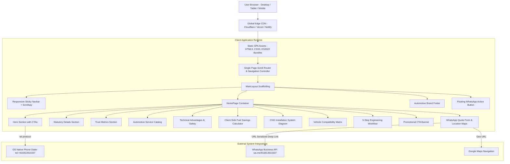

# Technical Requirements Document (TRD)

## Project Information
- **Project Name:** Maa Kamakhya Auto Gas Web Platform
- **Legal Entity:** Maa Kamakhya Auto Gas
- **Document Version:** 1.0.0 (Production Release)
- **Status:** Approved / Architecture Baseline
- **Last Updated:** 2026-11-15
- **Document Owner:** Principal Software Architect & Lead Frontend Engineer

---

## 1. Technical Overview
The Maa Kamakhya Auto Gas web platform is architected as an ultra-fast, responsive, client-side Single Page Application (SPA). It is built with React 18, bundled with Vite 5, styled with modern CSS3 variables and BEM methodology, and powered by tree-shakeable Lucide React icons. 

The application architecture prioritizes instantaneous interactivity, zero-dependency client-side financial calculations, seamless deep-linking into the WhatsApp Business API, and fluid 60fps automotive micro-interactions.

---

## 2. Technology Stack

| Layer | Technology | Version | Purpose & Rationale |
|---|---|---|---|
| **Core Framework** | React | 18.2.0 | Declarative UI, functional component architecture, state management with hooks (`useState`, `useMemo`, `useEffect`, `useCallback`). |
| **Build & Dev Tool** | Vite | 5.2.0 | Instant HMR (Hot Module Replacement), ES module imports, Rollup production optimization, and fast build times. |
| **Language** | JavaScript (ES2022) | Native | Pure, modern JavaScript without compilation bloat; high maintainability and developer ergonomics. |
| **Iconography** | Lucide React | ^0.344.0 | Clean, lightweight SVG icons tree-shaken into the bundle. |
| **Styling** | Modern CSS3 | Standard | CSS Custom Properties (design tokens), Flexbox, CSS Grid, clamp() responsive typography, and GPU-accelerated keyframe animations. |
| **Typography** | Google Fonts | Web | `Outfit` (automotive geometric headings) + `Plus Jakarta Sans` (ergonomic body text). |
| **Testing Harness** | Node.js Test Runner | Native | Zero-dependency automated test runner covering Unit, Integration, and Simulated E2E flows. |

---

## 3. System Architecture



---

## 4. Frontend Architecture & Design Principles
1. **Unidirectional Data Flow:** Data originates from immutable centralized configuration modules (`src/data/`) and flows down through components via props.
2. **Pure Utility Computations:** Core algorithmic logic (fuel savings calculations, currency formatting, URL construction) is isolated into pure JavaScript functions in `src/utils/` with 100% unit test coverage.
3. **Zero Layout Shift (CLS):** Explicit aspect ratios and skeleton containers are enforced on all image and media wrappers.
4. **Resilient Offline First Behavior:** The static application functions completely without active internet for core browsing and calculation; internet connectivity is only required to initiate external WhatsApp and phone dispatches.

---

## 5. Component Architecture

```
src/
├── components/          # Atomic / Reusable Dumb Components
│   ├── Button.jsx           # High-contrast button with primary/secondary/accent variants
│   ├── Logo.jsx             # Dynamic SVG brand vector with Yellow + White typography
│   ├── Navbar.jsx           # Sticky blurred header, desktop links, mobile hamburger drawer
│   ├── Footer.jsx           # Multi-column footer with statutory info, links, and copyright
│   ├── SectionHeading.jsx   # Consistent typography hierarchy with accent pill badges
│   ├── ServiceCard.jsx      # Interactive card with icon, feature bullets, and quote trigger
│   ├── RevealAnimation.jsx  # Intersection-Observer-based scroll animation wrapper
│   └── WhatsAppButton.jsx   # Floating pulsing action trigger
│
├── layouts/             # Structural Page Wrappers
│   └── MainLayout.jsx       # Global scaffolding containing Navbar, main, Footer, and FloatingCTA
│
├── pages/               # Top-Level Page Views
│   └── HomePage.jsx         # Section assembler with Section IDs and smooth scroll coordination
│
├── sections/            # Domain-Specific Single-Responsibility Sections
│   ├── Hero.jsx             # Headline, boot cylinder visual, primary CTAs
│   ├── StatutoryDetails.jsx # Legal credentials, GSTIN, Est. 2022, Payment modes
│   ├── TrustIndicators.jsx  # 3,500+ installs, 55% savings, 100% safety record
│   ├── WhyChooseUs.jsx      # Value cards (Savings, Environment, Engineering)
│   ├── Services.jsx         # 6 automotive service cards
│   ├── Benefits.jsx         # 6 technical safety and performance benefits
│   ├── SavingsCalculator.jsx# Dynamic slider + fuel price inputs + live reactive savings output
│   ├── SystemOverview.jsx   # Visual car cutaway diagram with component annotations
│   ├── VehicleCompatibility.jsx # Interactive automotive brand tabs (Maruti, Hyundai, Tata, etc.)
│   ├── Process.jsx          # 5-step engineering and testing workflow
│   ├── CTASection.jsx       # High-conversion promotional banner
│   └── Contact.jsx          # WhatsApp inquiry form, workshop address, business hours, Google Map
│
├── data/                # Static Business Configurations
│   ├── siteConfig.js        # Official brand name, phone, WhatsApp, address, statutory details
│   ├── navigation.js        # Section links, anchors, and order
│   └── services.js          # Services, benefits, compatibility, and process data
│
├── utils/               # Pure Helper Functions
│   ├── calculator.js        # Pure fuel savings calculation algorithm
│   └── formatCurrency.js    # Indian Rupee (INR) and distance formatters
│
├── services/            # Integration Services
│   ├── whatsappService.js   # WhatsApp deep-link builder and encoder
│   └── quoteService.js      # Quote serialization and prefill handlers
│
├── styles/              # Global Styling
│   ├── variables.css        # CSS Custom Properties (Colors, Typography, Shadows, Spacing)
│   └── index.css            # Base resets, typography, layout utilities, animations
│
├── config/              # Application Constants
│   └── constants.js         # Default fuel prices, mileage baselines, breakpoints
│
├── App.jsx              # Application Root
└── main.jsx             # React DOM Hydration Entry Point
```

---

## 6. Routing & Navigation Strategy
The MVP is implemented as a performant Single Page Application (SPA).
- **Navigation Type:** Anchor-based smooth scrolling (`scroll-behavior: smooth`) coupled with an Intersection Observer-driven Scrollspy.
- **Scroll Offset:** A calibrated 80px scroll margin (`scroll-margin-top: 80px`) is enforced across all section targets to eliminate header occlusion.
- **History Management:** Hash updates (`#calculator`, `#services`, `#contact`) occur seamlessly without triggering full document reloads.
- **Mobile Drawer Behavior:** Selecting any navigation item in mobile view automatically closes the slide-out menu drawer and triggers a smooth scroll to the target.

---

## 7. State Management Strategy
The application employs lightweight, reactive React component state:
1. **Local State (`useState`):**
   - Active navigation item in `Navbar.jsx`.
   - Distance slider value, fuel tariffs, and mileage parameters in `SavingsCalculator.jsx`.
   - Selected automotive brand tab in `VehicleCompatibility.jsx`.
   - Form input fields and validation error dictionaries in `Contact.jsx`.
   - Mobile menu toggle (`isOpen`) in `Navbar.jsx`.
2. **Derived State (`useMemo`):**
   - Petrol monthly expenditure, CNG monthly expenditure, and net monthly/annual savings in `SavingsCalculator.jsx`. Re-evaluated only when slider or input parameters change.
3. **Cross-Section Communication:**
   - Handled via custom browser events or state hooks. For instance, clicking "Get Specific Estimate" in `Services.jsx` or "Apply Estimate to WhatsApp" in `SavingsCalculator.jsx` dispatches a prefill event to `Contact.jsx` and triggers a smooth scroll into view.

---

## 8. Data Management & Validation
- **Configuration Immutability:** All business data in `src/data/` is declared as immutable `const` structures.
- **Input Validation Rules:**
  - `distance`: Numeric range between $500\text{ km}$ and $10,000\text{ km}$.
  - `petrolPrice`: Numeric range between ₹$50/\text{L}$ and ₹$200/\text{L}$.
  - `cngPrice`: Numeric range between ₹$40/\text{kg}$ and ₹$180/\text{kg}$.
  - `petrolMileage`: Numeric range between $6\text{ km/L}$ and $35\text{ km/L}$.
  - `cngMileage`: Numeric range between $10\text{ km/kg}$ and $50\text{ km/kg}$.
  - `phone`: Regular expression validation matching standard 10-digit Indian mobile numbers (`/^[6-9]\d{9}$/`).
  - `name`: String trimmed, minimum 2 characters.

---

## 9. Responsive Design Implementation
The application adheres to a mobile-first design philosophy using responsive CSS Grid and Flexbox:
- **CSS Breakpoints:**
  - Mobile Small: `320px – 479px`
  - Mobile Large: `480px – 639px`
  - Tablet: `640px – 1023px`
  - Desktop: `1024px – 1279px`
  - Large Desktop: `1280px – 1535px`
  - Ultra-Wide: `≥ 1536px`
- **Fluid Typography:** Implemented via CSS `clamp()` functions:
  - Hero Title: `clamp(2.1rem, 5.2vw, 3.8rem)`
  - Section Headings: `clamp(1.75rem, 3.8vw, 2.75rem)`
  - Body Text: `clamp(0.95rem, 1.2vw, 1.1rem)`
- **Dynamic Layout Reflow:** Multi-column grids automatically collapse to single-column vertical stacks on viewports $< 768px$.

---

## 10. Animation & Micro-Interaction Implementation
1. **GPU Acceleration:** All CSS transitions and animations strictly use `transform` and `opacity` to avoid triggering layout reflows or repaints.
2. **Scroll Reveal:** `RevealAnimation.jsx` uses an `IntersectionObserver` with a `threshold: 0.1` and `rootMargin: '0px 0px -50px 0px'` to gracefully fade and slide sections upward upon scroll entry.
3. **Floating Pulse Effect:** The floating WhatsApp button features a gentle continuous radial pulse (`@keyframes pulse-ring`) that draws visual attention without distracting from content reading.
4. **Reduced Motion Accessibility:** A universal media query cleanly neutralizes all animations when requested by the operating system:
   ```css
   @media (prefers-reduced-motion: reduce) {
     *, *::before, *::after {
       animation-duration: 0.01ms !important;
       animation-iteration-count: 1 !important;
       transition-duration: 0.01ms !important;
       scroll-behavior: auto !important;
     }
   }
   ```

---

## 11. Performance Budgets & Optimization
- **Production Asset Bundling:** Vite's Rollup pipeline chunks assets into optimized modules.
- **Vector Graphics:** All brand logos, component schematics, and functional icons are rendered as inline SVG vectors, completely eliminating network latency and pixelation artifacts.
- **Font Optimization:** Google Fonts loaded with `font-display: swap` and preconnect links to `fonts.googleapis.com` and `fonts.gstatic.com`.
- **Target Metrics:**
  - Total JS Bundle Size (Minified): $\le 250\text{ KB}$
  - Total JS Bundle Size (Gzip): $\le 70\text{ KB}$
  - Total CSS Size (Gzip): $\le 10\text{ KB}$
  - Total DOM Elements: $\le 800$

---

## 12. Security Architecture
- **Zero Server Exposure:** The static frontend contains no backend application servers, preventing traditional server-side vulnerabilities (SQL injection, remote code execution).
- **Safe Deep Links:** All external URLs use `rel="noopener noreferrer"` to prevent reverse tabnabbing.
- **URI Encoding:** All query strings constructed for the WhatsApp Business API are strictly processed through `encodeURIComponent()` to prevent protocol manipulation.

---

## 13. Browser Compatibility Matrix

| Platform | Browser | Minimum Version | Verification Status |
|---|---|---|---|
| Windows / macOS / Linux | Google Chrome | 90+ | Verified |
| Windows / macOS | Microsoft Edge | 90+ | Verified |
| Windows / macOS / Linux | Mozilla Firefox | 88+ | Verified |
| macOS / iOS / iPadOS | Apple Safari | 14+ | Verified |
| Android | Chrome for Android | 90+ | Verified |
| iOS | Safari for iOS | 14+ | Verified |
| Android | Samsung Internet | 15+ | Verified |

---

## 14. Testing & Verification Suite
The project integrates a comprehensive automated verification harness executed via `node test-suite.js`:
1. **Unit Tests (`tests/unit/`):**
   - `calculator.test.js`: Verifies exact mathematical outputs for petrol cost, CNG cost, monthly savings, and annual savings under varied travel distances and tariff rates.
   - `formatCurrency.test.js`: Verifies Indian currency formatting (₹ commas) and kilometre suffixes.
2. **Integration Tests (`tests/integration/`):**
   - `siteConfig.test.js`: Verifies brand name ("Maa Kamakhya Auto Gas"), statutory credentials, phone numbers, and WhatsApp links.
   - `navigation.test.js`: Verifies anchor targets and navigation integrity.
3. **E2E Simulation (`tests/e2e/`):**
   - `userFlow.test.js`: Simulates full user flow from distance calculation to WhatsApp quote link generation.
